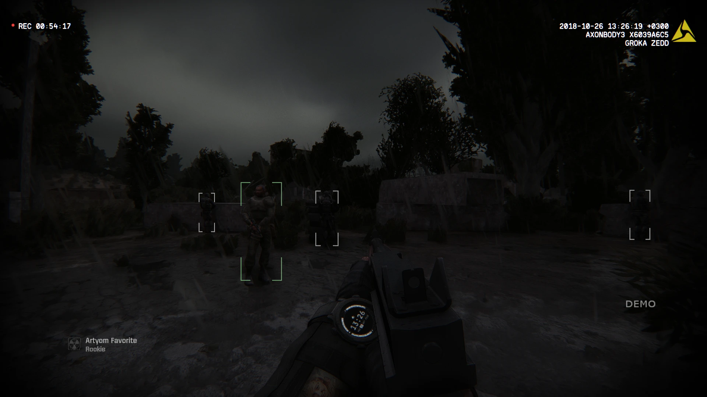

<div align="center">

<sub>S.T.A.L.K.E.R. ANOMALY / G.A.M.M.A.</sub>

# ZONE BODYCAM
### CHEST-MOUNTED BODYCAM LENS, CMOS SENSOR, MOTION & TACTICAL OVERLAY

*Wide-angle optical housing, Axon CMOS sensor pipeline, chest body motion, and line-of-sight tactical markers.*

  

</div>

[](docs/images/gameplay.mp4)

<sub>Gameplay clip. Click it for the full-quality MP4 with sound.</sub>



---

## Features

- **Post-Upscale Optical Fisheye & Housing** (`gamedata/shaders/r3/zbc_lens.h`, `postprocess.ps`, `postprocess_cm.ps`):
  Runs in the display-resolution post chain after DLSS/FSR reconstruction via `shader_bus`, so upscalers never see barrel distortion. Includes radial chromatic aberration, peripheral optical softness, sensor sharpening, configurable circle-to-squircle bezel geometry (`housing_roundness`), motion-reactive neutral vignette (`edge_follow`), and dynamic chest-rig / shoulder / weapon-aim frame occlusion.
- **Axon-Style CMOS Sensor Pipeline**:
  Small-sensor highlight blowout roll-off, subtle digital video compression & horizontal chroma bleed, cool-neutral CMOS contrast grade, 30 Hz sensor grain, and signed horizontal rolling-shutter shear on rapid turns, gunfire, and hits.
- **Chest Body Motion** (`gamedata/scripts/zbc_bodycam.script`):
  Frame-rate independent two-stage damped tracking for turn lag, walking gait bob & roll, breathing, crouch/lean shifts, and spring-damped impacts (steps, landings, jumps, shots, hits). Always active across HUD and UI states when enabled.
- **In-Shader Top-Right Axon Overlay** (`gamedata/shaders/r3/zbc_osd.h`, `zbc_osd_atlas.script`):
  Displays in-game date/time (`Zone` `+0200`/`+0300` summer or `UTC +0000`, optional `ISO T`), configurable device label & serial (`AXON BODY 3`), character name, and logo (`ui\zbc_logo.dds`, swirl triangle, plain triangle, or hidden). Composited inside `postprocess` after fisheye warp and above the corner vignette—so text stays unwarped while passing through CMOS compression, grading, grain, and rolling-shutter shear.
- **Recording Timer (top left)** (`gamedata/scripts/zbc_bodycam.script`, `zbc_osd.h`):
  A flashing red dot and `REC HH:MM:SS` showing how long the camera has been recording in this playthrough. It uses the overlay font and mirrors the top-right margin. The time is real time, stored on the actor, so it carries through saves and level changes. It can be turned off in MCM and is on by default.
- **Line-of-Sight Ally & Companion Markers** (`gamedata/scripts/zbc_allies.script`):
  Marks friendly/neutral stalkers and companions (never enemies) through the exact inverse lens warp (`unwarp`) using a fixed pool of 20 reusable HUD statics. Uses real-time 20 Hz `ray_pick` camera line-of-sight that blocks on solid opaque geometry (`FL_VISION_OPAQUE` / `gamemtl.xr` bit 30) while seeing through foliage (`FL_PASSABLE`), fences, water, and destructible object glass, with smooth pop-in/out (`0.40 s`), quick death fade (`0.20 s`), and bidirectional bracket-to-dot morphing (`~0.56 s`).
- **Automatic Aspect-Ratio Scaling**:
  Works out of the box across `4:3`, `16:10`, `16:9`, `21:9` (`2560x1080`, `3440x1440`), and `32:9` (`5120x1440`) without separate FOMOD patches—preventing ultrawide barrel-warp side clipping, matching 16:9 vignette framing, keeping `unwarp` aligned, and preserving consistent top-right Axon overlay sizing.
- **Full MCM Support** (`gamedata/scripts/zbc_bodycam_mcm.script`):
  In-game sliders and toggles for Master Toggle, Lens & Sensor, Body Motion, Overlay, and Ally Markers.

---

## Requirements

- **S.T.A.L.K.E.R. Anomaly 1.5.3** (tested on **G.A.M.M.A.**)
- **xray-monolith-bodycam (Slop-Ray engine)** with `shader_bus` support for the post-process lens, CMOS pipeline, and in-shader overlay *(falls back gracefully to HUD overlay if Shader Bus is unavailable)*
- **MCM (Mod Configuration Menu)** recommended

---

## Installation

1. Install into **Mod Organizer 2** as its own mod containing `gamedata/` (above mods providing vanilla `postprocess.ps` / `postprocess_cm.ps` overrides, if applicable).
2. Clear `Anomaly/appdata/shaders_cache` before launching so DX11 shaders recompile cleanly.
3. Configure preferences in **MCM -> Zone Bodycam**.

---

## Repository Layout

```text
.
├── docs/images/            # README screenshots and gameplay clip
├── fomod/                  # FOMOD installer metadata (info.xml, ModuleConfig.xml)
├── gamedata/
│   ├── configs/            # UI XML & MCM English localization (ui_st_zbc_bodycam.xml)
│   ├── scripts/            # Motion, Shader Bus driver, MCM, baked OSD atlas, LOS ally markers
│   ├── shaders/r3/         # Lens, CMOS sensor, OSD compositing, and HUD marker shaders
│   └── textures/ui/        # Pre-built glyph atlas (zbc_font.dds) & logo texture (zbc_logo.dds)
├── tools/
│   ├── make_overlay_assets.py
│   └── source_assets/      # Font & logo source assets for regenerating DDS textures & font metrics
└── meta.ini                # MO2 mod metadata
```

### Regenerating Overlay Textures

Requires Python + Pillow (`PIL`):

```bash
py -I tools/make_overlay_assets.py tools/source_assets/KlartextMonoBold.ttf tools/source_assets/logo.png gamedata
```
