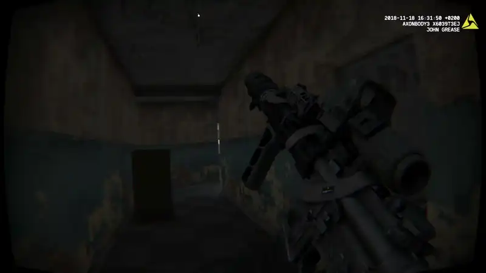

<div align="center">

<sub>S.T.A.L.K.E.R. ANOMALY / G.A.M.M.A.</sub>

# ZONE BODYCAM

*See the Zone through a chest-mounted police bodycam.*

  

[](docs/images/gameplay.mp4)

<sub>Recorded on the modded <a href="https://github.com/asuparabekon/xray-monolith-bodycam">Bodycam exes</a> (such as Slop-Ray) with their <b>Immersive Bodycam</b> camera on. The free-floating camera and weapon movement come from the Bodycam exes, <b>not from this mod</b>. Click the clip for the full-quality video with sound.</sub>

</div>

## What you get

- **Bodycam lens.** Fisheye view with the camera housing around the edges, a small-sensor look, grain and a slight wobble when you turn fast or get hit. The lens zooms in by itself, so stronger fisheye never leaves black edges.
- **Chest-mounted feel.** The lens housing and vignette lag behind your turns, bob with your steps, and jolt when you land, shoot or get hit. The image itself only sways slightly. Your view and aim stay where the game puts them; this mod doesn't detach the camera from your weapon.
- **Bodycam overlay.**
  - **Top right:** in-game date and time, device name and serial, your character's name and the logo.
  - **Top left:** a flashing red dot and `REC 00:54:17`, showing how long you've been recording this playthrough. It counts real time and is kept in your save.
- **Ally markers.** Friendly and neutral stalkers you can see get a box, so you know who not to shoot. Enemies are never marked.
- **Every screen shape.** 4:3, 16:9, ultrawide 21:9 and 32:9 all work out of the box.

Everything can be tuned or turned off in MCM.


## Requirements

- S.T.A.L.K.E.R. Anomaly 1.5.3. Made and tested on G.A.M.M.A.
- **[Modded exes](https://github.com/themrdemonized/xray-monolith/releases) 2026.10.11 or newer** for the lens. They include the Shader Bus it needs. The [Slop-Ray engine](https://github.com/asuparabekon/xray-monolith-bodycam) works too. With older exes the lens is off, but the overlay and markers still work.
- **MCM** to change settings (recommended).

## Installation

1. Install the archive with Mod Organizer 2 like any other mod.
2. If another mod also replaces `postprocess.ps` or `postprocess_cm.ps`, give Zone Bodycam higher priority (put it lower in MO2's left pane).
3. Delete the contents of `Anomaly\appdata\shaders_cache` once, so the new shaders are built.
4. Start the game and open **MCM → Zone Bodycam**.

## Settings

| Section | What you can change |
|---|---|
| **Lens** | Strength, fisheye, zoom, chromatic aberration, sharpening, edge size and shape, vignette, grain, colour grade, rolling shutter |
| **Body motion** | Overall amount, turn lag, walking bob, camera roll, impacts, breathing |
| **Overlay** | Overlay on/off, recording timer on/off, device name, show your name, logo style, time zone, text size and opacity |
| **Ally markers** | On/off, only NPCs you can see, style, colours, range, size, opacity |

## Good to know

- **Black edges or a broken screen after updating?** Clear `Anomaly\appdata\shaders_cache` and restart.
- **Too much fisheye?** Lower **Fisheye distortion**. The zoom adjusts by itself. **Lens zoom** only adds extra crop on top.
- **Using a run timer mod?** Run timers usually sit in the top-left corner too. Move them, or turn off the recording timer in MCM.
- **Changes** are listed in [CHANGELOG.md](CHANGELOG.md).

## Credits

- Mod by **Damage_Zedd**.
- **themrdemonized** and the modded exes contributors for the Shader Bus the lens runs on.
- **asuparabekon** for [xray-monolith-bodycam (Slop-Ray)](https://github.com/asuparabekon/xray-monolith-bodycam), the engine the mod was built on.
- Body motion based on the damped camera chase from **Sludge's Intrusive 3D Masks**.

<details>
<summary><b>For modders</b></summary>

<br>

- Lens, sensor and overlay are drawn in `postprocess.ps` / `postprocess_cm.ps` (`gamedata/shaders/r3/zbc_*.h`), with values sent through the modded exes' Shader Bus (version 7: `try_register`, `set_array_uint`). On Slop-Ray this pass runs after DLSS/FSR, so the upscaler never sees the warp.
- Scripts: `zbc_bodycam.script` (settings, motion, overlay, timer), `zbc_allies.script` (markers), `zbc_bodycam_mcm.script` (menu).
- The overlay font and logo textures are generated from `tools/source_assets`. To rebuild them (needs Python and Pillow):

  ```bash
  py -I tools/make_overlay_assets.py tools/source_assets/KlartextMonoBold.ttf tools/source_assets/logo.png gamedata
  ```

</details>
