<div align="center">

<sub>S.T.A.L.K.E.R. ANOMALY / G.A.M.M.A.</sub>

# ZONE BODYCAM

*See the Zone through a chest-mounted police bodycam.*

  

[](docs/images/gameplay.mp4)

<sub>Recorded on the modded <a href="https://github.com/asuparabekon/xray-monolith-bodycam">Bodycam exes</a> (such as Slop-Ray) with their <b>Immersive Bodycam</b> camera on. The free-floating camera and weapon movement come from the Bodycam exes, <b>not from this mod</b>. Click the clip for the full-quality video with sound.</sub>

</div>

## What's new in v1.5.0

- **1:1 real Axon Body 1–5 specs** ([docs/real_specs.md](docs/real_specs.md)): sharpness mapped to real resolution (`480p / 1080p / 1080p / 1440p / 4K`), lens zoom to real FOV (`130° / 143° / 143° / 160° / 160°`), compression to real bitrates, night noise, and reduced motion blur from Body 3+. Live-map markers, companion dots, and the alerts log require LTE (Body 3+); scope tags require Watch Me (Body 4+); overlay name starts at Body 2+ and GPS at Body 3+.
- **Game-time battery life matching the real cameras**: Body 4 lasts **14 in-game hours** (new MCM option `"Battery life (game hours)"`), Body 1–3 last **12 hours**, and Body 5 lasts **~16.8 hours** (+20%), scaling with `time_factor`.
- **1×1 inventory icons, optional HD icons & blue charge bar**: Bodycam items now take a single 1×1 inventory cell by default (with an optional **HD icons** FOMOD step for HD Inventory Icons Framework), show the vanilla blue battery bar on their icon, and the Bodycam item component is now **on by default** in the installer.
- **Automatic overlay device name**: Always shows the carried camera's real model (`AXON BODY` through `AXON BODY 5`) unless the new off-by-default `"Custom device name"` MCM toggle is enabled.
- **IR night look is now off by default** and available as an MCM option on every camera (no real Axon Body has infrared).
- **Fixes:** smooth turn-based compression without the 1.6 s keyframe snap; battery-insert animation now plays for all 5 cameras when carrying multiple cameras; fixed float32 battery drain stalling near full charge.

Full history in [CHANGELOG.md](CHANGELOG.md).

## What you get

- **Bodycam lens.** Fisheye view with the camera housing around the edges, a small-sensor look, grain and a slight wobble when you turn fast or get hit. The lens zooms in by itself, so stronger fisheye never leaves black edges. Visible NPC faces are automatically pixelated into a coarse mosaic before the lens warp.
- **Chest-mounted feel.** The lens housing and vignette lag behind your turns, bob with your steps, and jolt when you land, shoot or get hit. The image itself only sways slightly. Your view and aim stay where the game puts them; this mod doesn't detach the camera from your weapon.
- **Bodycam overlay.**
  - **Top right:** in-game date and time, device name and serial, your character's name, optional GPS coordinates, and the logo (in English and Russian).
  - **Top left:** a flashing red dot and `REC 00:54:17` (plus `EVENT` when firing or taking a heavy hit), showing how long you've been recording this playthrough. It counts real time and is kept in your save.
- **Camera effects.** Interference in emissions, psy storms, psy fields, radiation, near anomalies and on heavy hits; `SIGNAL LOST` feed cutoff on death; an optional low-light infrared mode at night and underground (off by default: no real Axon Body has IR); the game's visor rain drops on the lens (mask or not, wiped with the mask-wipe key) and blood splatter.
- **Entity markers.** Stalkers (friendly, neutral, companion and enemies) and mutants you can see get a box with their name/species and faction, decoding from scrambled text by distance and scope zoom (dots past a distance).
- **Every screen shape.** 4:3, 16:9, ultrawide 21:9 and 32:9 all work out of the box.
- **English & Russian.** Full localization for all MCM menus, overlay text, marker labels, mutant species, and the optional Body Camera item.

Everything can be tuned or turned off in MCM.

## Camera effects in motion

| Interference and signal lost | Blood on the lens |
|:---:|:---:|
| [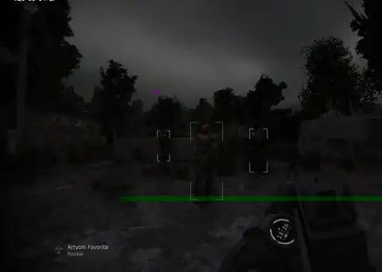](docs/images/fx_interference.mp4) | [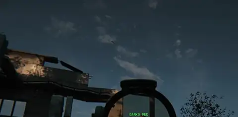](docs/images/fx_blood.mp4) |
| Interference in a psy field, near an anomaly and in a full emission, two hard hits, then the feed dies block by block to SIGNAL LOST. | A hit right in front of the camera: an irregular splash that drips like blood on glass (slowed, then sped up), and splatters stacking. |

| Night mode (IR, optional) and compression |
|:---:|
| [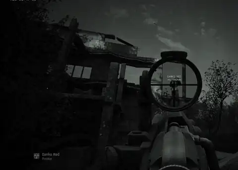](docs/images/fx_ir_compression.mp4) |
| IR night mode: the lamp lights the middle, the gain hunts and dark areas boil in blocks. Compression: steady baseline set by the camera, building up while you turn and easing back. |

<sub>Shader previews rendered over game screenshots, not game recordings. Click a clip for the full-quality video.</sub>

## Screenshots

| Front-only face blur, skeleton markers & AXON BODY 4 overlay | Optional low-light infrared (IR) mode (off by default) & aim-only labels |
|---|---|
| 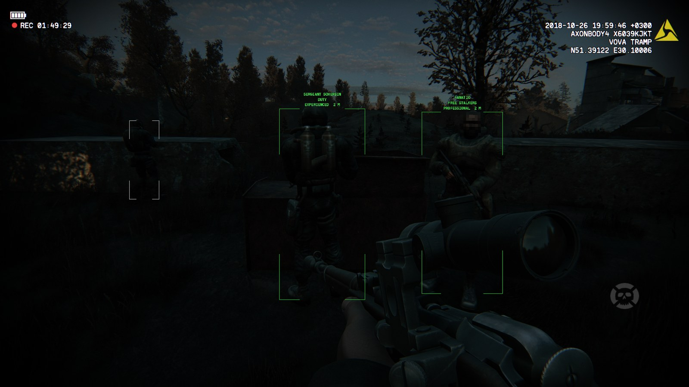 | 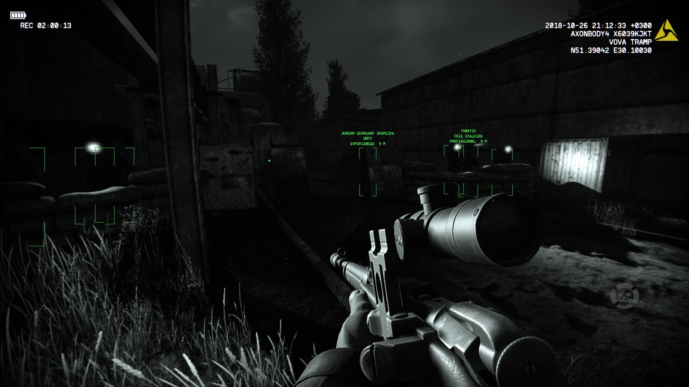 |

| 3DSS Picture-in-Picture scope target identification | Footage Review event timeline (`Delete`) |
|---|---|
| 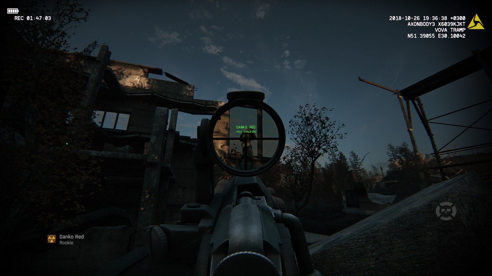 | 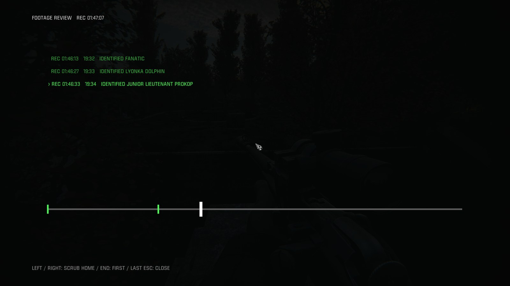 |


## Optional: Body Camera item

**Bodycam item (battery powered)** is on by default in the installer to make the bodycam a real piece of gear (untick it to keep the bodycam always on). Standard 1×1 icons are included, with an optional **HD icons** step for HD Inventory Icons Framework.

- **Five generations, Axon Body 1 to 5** (see below). The effect only runs while you carry a charged camera anywhere in your inventory. No equipment slot is used.
- **It runs on batteries.** The battery drains while recording, in game time, as long as the real camera lasts: 12 in-game hours for Body 1-3, 14 for Body 4 and about 16.8 for Body 5 (Body 4's value is set in MCM). Each camera shows a blue charge bar on its inventory icon, and a small VHS-style battery gauge sits above the REC dot.
- **When it dies,** the lens, overlay and markers switch off. Your character taps the camera, unclips it, checks it and puts it away.
- **Swap the battery** like any vanilla device: drag a battery onto the camera. Your character slides it in and clips the camera back on your chest.
- The REC timer keeps counting in the background while the camera is off.

<div align="center">

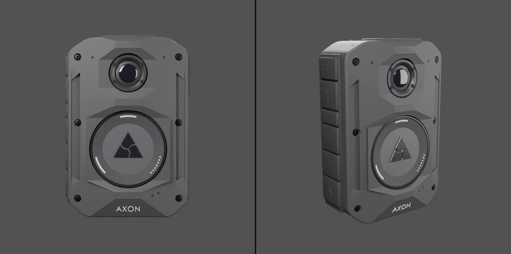

[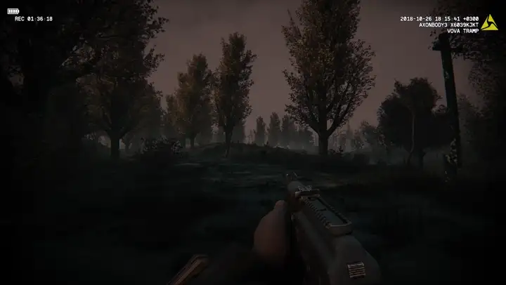](docs/images/bodycam_item.mp4)

<sub>Click the clip for the full-quality video.</sub>

</div>

### Camera generations

The camera you carry decides what the feed can do, matched one to one to the real Axon Body cameras' published specs (sources: [docs/real_specs.md](docs/real_specs.md)). **Axon Body 1 is the worst, Axon Body 5 the best.** Body 4's picture is the reference and looks exactly like your MCM settings.

| | Body 1 | Body 2 | Body 3 | Body 4 | Body 5 |
|---|---|---|---|---|---|
| Real camera | 2013, 480p, 130° | 2015, 1080p, 143° | 2019, 1080p, ~143° (est.), LTE | 2023, 1440p, 160° | 2026, up to 4K |
| Sharpness / lens | softest, narrowest | sharper, wider | as Body 2, less motion blur | reference | sharpest |
| Compression | heaviest | heavy | medium | reference | lightest |
| Night noise | most | most | less | reference | least |
| Battery (real) | 12 h | 12 h | 12 h | 14 h | +20% |
| Markers / alerts log | no | no | yes (enemies) | + mutants, scope tags | + fastest identification |

Overlay: Body 1 shows date and device only, Body 2 adds your name, Body 3 and up add the GPS line (onboard GPS). The IR night look is an MCM option on every camera, off by default.

- **Axon Body 1:** sold by every trader for 5,000 RU, and every new game starts with one. It can also be crafted with a basic toolkit.
- **Axon Body 2 to 5:** craft only, each from the generation before, behind the same electronics recipe books as GAMMA's night vision goggles.
- Turn **Camera generations** off in the MCM to make every camera work like Body 4.

<div align="center">

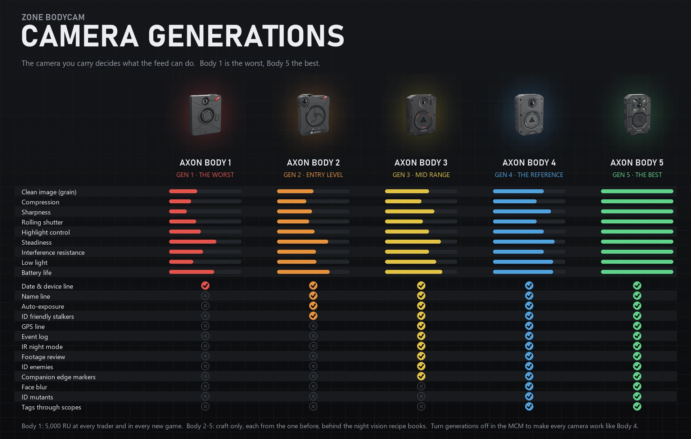

| | |
|:---:|:---:|
| 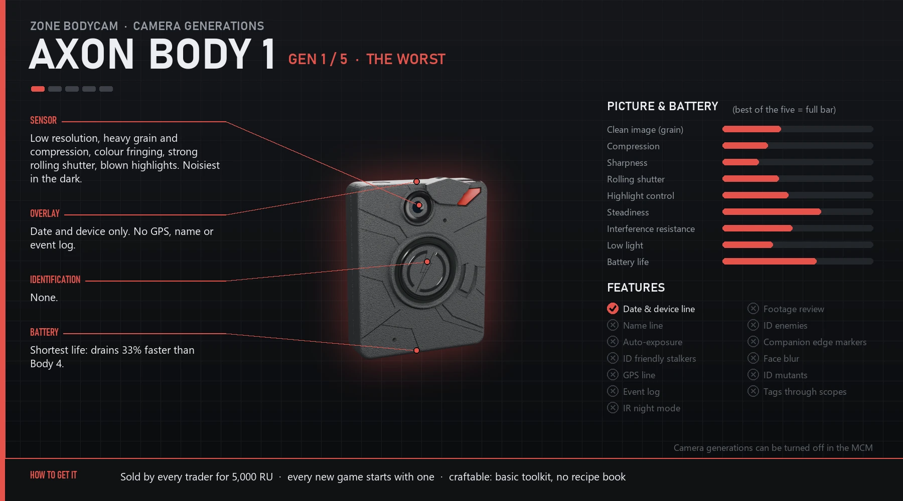 | 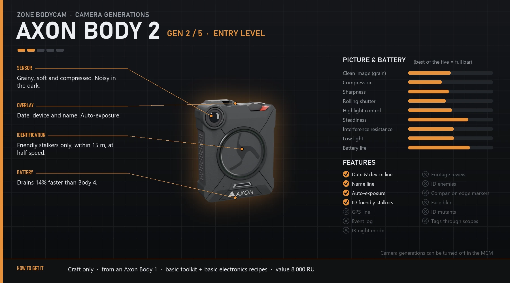 |
| 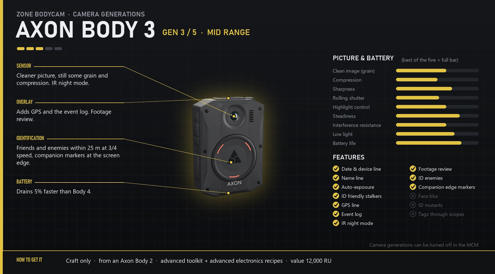 | 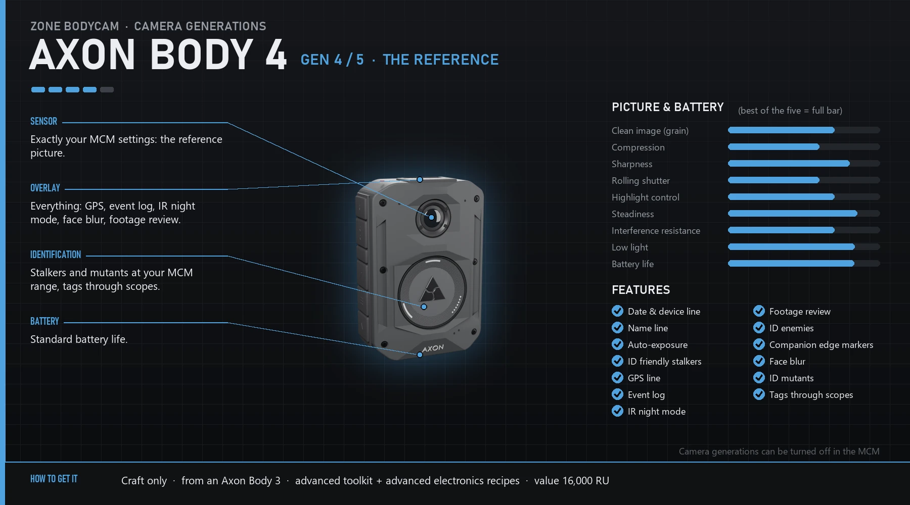 |
| 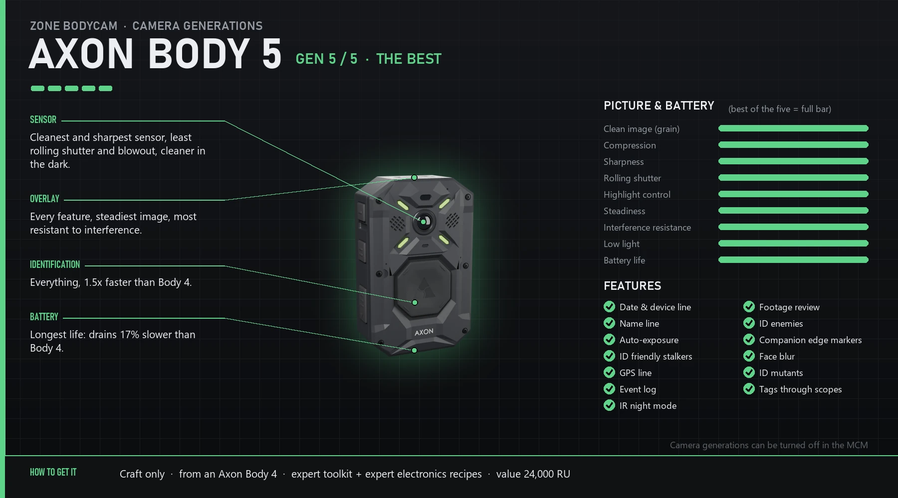 | |

</div>

## Requirements

- S.T.A.L.K.E.R. Anomaly 1.5.3. Made and tested on G.A.M.M.A.
- **[Modded exes](https://github.com/themrdemonized/xray-monolith/releases) 2026.10.11 or newer** for the lens, face pixelation, and in-shader overlay/effects (Shader Bus 7). The [Bodycam exes](https://github.com/asuparabekon/xray-monolith-bodycam) (such as Slop-Ray) work too — G.A.M.M.A. users running the Bodycam exes also need the **Bodycam GAMMA Patch**. On older exes the lens and face pixelation are off (or Shader Bus <= 6 keeps the lens with the 2D HUD overlay fallback), while the overlay and markers still work.
- **MCM** to change settings (recommended).
- For rain on the lens: the game's visor drops (Dynamic Visor Drops in G.A.M.M.A.). **Dynamic Smoother Droplets** must be off: it breaks Dynamic Visor Drops.

## Installation

1. Install the archive with Mod Organizer 2 like any other mod. The installer asks whether you want the optional Body Camera item.
2. If another mod also replaces `postprocess.ps` or `postprocess_cm.ps`, give Zone Bodycam higher priority (put it lower in MO2's left pane).
3. Delete the contents of `Anomaly\appdata\shaders_cache` once, so the new shaders are built.
4. Start the game and open **MCM → Zone Bodycam**.

## Settings

| Section | What you can change |
|---|---|
| **Lens** | Strength, fisheye, zoom, chromatic aberration, sharpening, housing edge on/off, edge size and shape, vignette, grain, colour grade, rolling shutter, blur faces |
| **Camera effects** | Interference on/off and strength, signal lost on death, low-light IR mode (auto/always/off, off by default), rain on the lens, blood on the lens, EVENT marker, GPS coordinates |
| **Body motion** | Overall amount, turn lag, walking bob, camera roll, impacts, breathing |
| **Overlay** | Overlay on/off, recording timer on/off, battery gauge on/off, device name (follows carried camera, or custom toggle), show your name, logo style, time zone, text size and opacity |
| **Ally markers** | On/off, only NPCs you can see, show names, mark enemies, mark mutants, style, friendly/enemy/companion colours, range, size, opacity |
| **Item** (optional) | Battery life, hand animations on/off, camera generations on/off |

## Good to know

- **Black edges or a broken screen after updating?** Clear `Anomaly\appdata\shaders_cache` and restart.
- **Too much fisheye?** Lower **Fisheye distortion**. The zoom adjusts by itself. **Lens zoom** only adds extra crop on top.
- **Using a run timer mod?** Run timers usually sit in the top-left corner too. Move them, or turn off the recording timer in MCM.
- **No rain on the lens?** Turn off Dynamic Smoother Droplets, then clear the shader cache. Without a mask the bodycam switches on the game's intact visor glass, which the drops need; it can add a faint glass edge in the corners.
- **Changes** are listed in [CHANGELOG.md](CHANGELOG.md).

## Credits

- Mod by **Damage_Zedd**.
- **themrdemonized** and the modded exes contributors for the Shader Bus the lens runs on.
- **asuparabekon** for the [Bodycam exes](https://github.com/asuparabekon/xray-monolith-bodycam) (such as Slop-Ray), the engine the mod was built on.
- Body motion based on the damped camera chase from **Sludge's Intrusive 3D Masks**.

<details>
<summary><b>For modders</b></summary>

<br>

- Lens, sensor and overlay are drawn in `postprocess.ps` / `postprocess_cm.ps` (`gamedata/shaders/r3/zbc_*.h`), with values sent through the modded exes' Shader Bus (version 7: `try_register`, `set_array_uint`). On Slop-Ray this pass runs after DLSS/FSR, so the upscaler never sees the warp.
- Scripts: `zbc_bodycam.script` (settings, motion, overlay, timer), `zbc_allies.script` (markers & distance identification), `zbc_faces.script` (face pixelation), `zbc_fx.script` (interference, signal lost, low-light, visor rain drops, blood, GPS), `zbc_osd_atlas_cyr.script` (Cyrillic shader glyphs), `zbc_bodycam_mcm.script` (menu), plus optional `zbc_item.script`, `zbc_item_anim.script`, `zbc_item_mcm.script`.
- The overlay font and logo textures are generated from `tools/source_assets`. To rebuild them (needs Python and Pillow):

  ```bash
  py -I tools/make_overlay_assets.py tools/source_assets/KlartextMonoBold.ttf tools/source_assets/logo.png gamedata tools/source_assets/RobotoMono-VariableFont_wght.ttf
  ```

</details>
